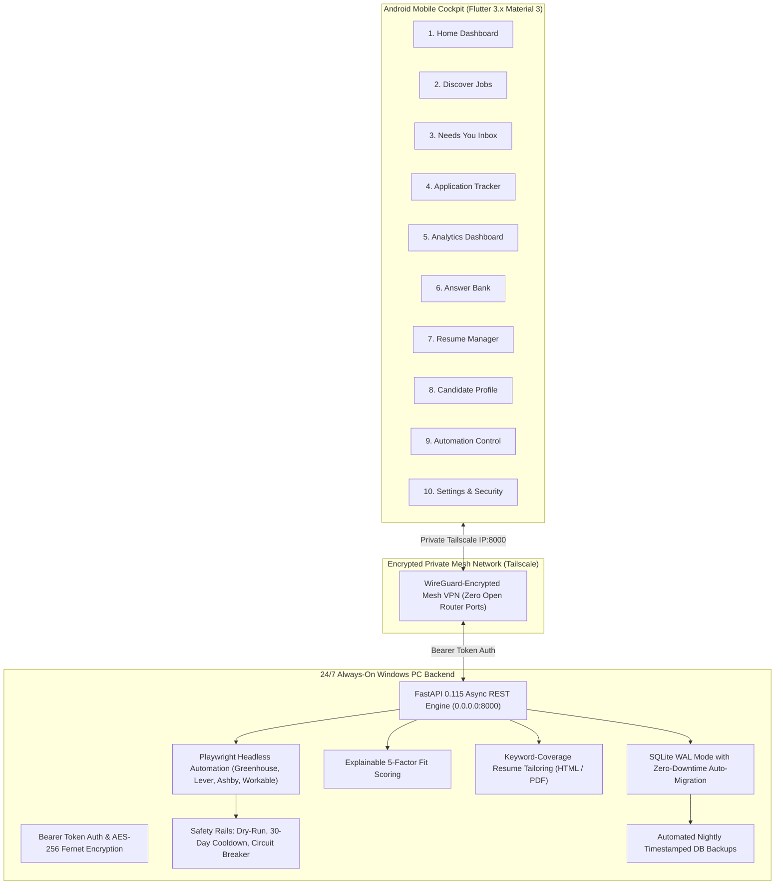

# ApplyPilot — Autonomous Career Command Center & Application Cockpit

[](https://opensource.org/licenses/MIT)
[](https://fastapi.tiangolo.com)
[](https://flutter.dev)
[](https://playwright.dev)
[](https://tailscale.com)
[]()

**ApplyPilot** is an autonomous, candidate-first job application cockpit designed for Android with an always-on Windows PC backend. It automates high-volume job discovery, explainable 5-factor fit scoring, dynamic resume tailoring, and ATS form filling, while escalating to you **only** when an application genuinely requires human input. Every answer you provide is permanently remembered in the Answer Bank and reused for future forms.

---

## System Architecture



---

## Unslopped Editorial Design System

ApplyPilot features a bespoke **unslopped** editorial aesthetic adhering to strict typography, color, and spacing guidelines:

- **Primary Identity**: Warm Ivory (`#FAFAF7`), British Racing Green (`#1B4332`), Pure White surfaces (`#FFFFFF`), and Muted Brass accents (`#C5A880` / `#D4AF37`).
- **Obsidian Dark Mode**: Deep Forest Slate (`#0D1912`, `#14251B`) with vibrant green glows (`#40916C`) and hairline border separation (`#253F30`).
- **Strict 4-pt Spacing Grid**: `s2` (2dp), `s4` (4dp), `s6` (6dp), `s8` (8dp), `s12` (12dp), `s16` (16dp), `s20` (20dp), `s24` (24dp), `s32` (32dp).
- **Typography**: Inter / Manrope hierarchy with strict tabular figures for metrics, financial values, and timestamps.
- **Micro-Interactions**: Haptic touch feedback, zero decorative placeholder controls, and full accessibility compliance (48dp minimum touch targets).

---

## 10 Dedicated Screens & Workflows

| # | Screen | Description |
|---|---|---|
| **1** | **Home Dashboard** | Career Command Center displaying today's progress vs target, active interviews, Needs You alerts, 7-day velocity chart, and live execution stream. |
| **2** | **Discover Jobs** | Job stream with explainable fit scores, remote/hybrid filters, company exclusion shortcuts, and one-tap resume tailor previews. |
| **3** | **Needs You Inbox** | Human-in-the-loop review queue for blocker questions. Quick-answer chips, custom editor, and automatic Answer Bank synchronization with auto-resume. |
| **4** | **Application Tracker** | Dual-view Kanban and List tracker across the 7-stage lifecycle (`Discovered` &rarr; `Evaluated` &rarr; `Approved` &rarr; `Submitted` &rarr; `Interview` &rarr; `Offer` / `Rejected`). Includes recruiter info, notes editor, and submission proof. |
| **5** | **Analytics Dashboard** | Real database metrics: 7-day velocity, monthly application volume, fit-score distribution histogram, ATS platform breakdown, and top companies. |
| **6** | **Answer Bank** | Candidate knowledge base distinguishing verified facts from AI suggestions, complete with source citations, proof points, reuse toggles, and CRUD controls. |
| **7** | **Resume Manager** | Resume portfolio with ATS compatibility scoring, live keyword-coverage simulation, missing qualification alerts, and master PDF export. |
| **8** | **Candidate Profile** | Live candidate identity, education, CGPA, target roles, preferred locations, excluded companies manager, and PyPDF resume parsing. |
| **9** | **Automation Control** | Operational cockpit featuring Dry-Run vs Live switch with double confirmation modal, emergency pause switch, daily/hourly caps, and real-time execution logs. |
| **10** | **Settings & Security** | Light/Dark theme toggle, Tailscale connection ping test, single-tap Bearer token rotation, nightly backup trigger, and database export. |

---

## Multi-Layer Safety Architecture

ApplyPilot is designed from the ground up to prevent spamming, duplicate submissions, account blacklisting, and hallucination:

1. **Dry-Run by Default**:
   - `profile.go_live` is initialized to `False`. The engine fills forms, uploads resumes, captures full-page confirmation screenshots, but **never clicks the final Submit button** without explicit user confirmation.
2. **Zero-Hallucination Bounded Intelligence**:
   - Every tailored resume and generated form answer is derived strictly from verified credentials in the database (e.g. VIT Vellore Integrated MTech CSE Data Science, 2 published patents, Agentic Code Intelligence benchmark, AWS Solutions Architect certification).
   - The engine never invents projects, GPAs, degrees, or employers.
3. **30-Day Per-Company Cooldown**:
   - The database enforces a strict 30-day deduplication window. Even across different job listings or job boards, ApplyPilot will never apply to the same company twice within a month.
4. **Safety Circuit Breakers**:
   - The automation queue automatically trips and enters an emergency pause if 3 consecutive failures, network drops, or CAPTCHA roadblocks occur.
5. **No CAPTCHA Bypassing**:
   - ApplyPilot never solves or automates CAPTCHA or bot challenges. Any challenge detected immediately halts the worker and escalates the application to the **Needs You Inbox** or Assist Mode.
6. **Configurable Daily & Hourly Caps**:
   - Hard rate-limiting caps ensure that candidate profiles stay within normal human browsing patterns (e.g., 20–50 applications/day).

---

## ATS Engine & Automation Support

| ATS Platform | Mode | Form Filling | File Upload | Confirmation Proof |
|---|---|---|---|---|
| **Greenhouse** | Full Auto / Dry-Run | Text, dropdowns, radio, checkboxes | Tailored PDF Upload | Full-page Screenshot |
| **Lever** | Full Auto / Dry-Run | Structured form fields & custom questions | Tailored PDF Upload | Full-page Screenshot |
| **Ashby** | Full Auto / Dry-Run | Dynamic multi-step reactive forms | Tailored PDF Upload | Full-page Screenshot |
| **Workable** | Full Auto / Dry-Run | Sectioned application questionnaires | Tailored PDF Upload | Full-page Screenshot |
| **LinkedIn / Naukri** | Assist Mode | Pre-filled clipboard sheets & tailored CV | One-tap browser launch | Manual verification |

---

## Backend API Specification

The FastAPI backend exposes 7 modular routers under `/api/v1`:

- **`/health`**: Server uptime, WAL mode integrity, connection status, pause state, and Go-Live gate status.
- **`/profile`**: Candidate profile management, target role/location management, excluded company lists, PDF master resume uploads, and Bearer token rotation (`POST /profile/rotate-token`).
- **`/answer-bank`**: Question-answer bank CRUD with verification flags, source evidence tags, and category indexing.
- **`/jobs`**: Ingestion, discovery triggers, explainable fit scoring (`POST /jobs/evaluate`), Kanban lifecycle board (`GET /jobs/kanban`), lifecycle status updates (`PUT /jobs/{id}/status`), notes/recruiter info updates, and PDF tailoring triggers.
- **`/needs-you`**: Blocker inbox management, quick-answer chip generation, and auto-resume execution.
- **`/resumes`**: Master resume version management, tailoring simulation with keyword coverage analysis, and ATS scoring.
- **`/analytics`**: Real-time aggregated database statistics, application velocity, match distribution, and platform breakdowns.

---

## Quickstart & Installation

### 1. Configure Windows Always-On Power Settings
Run from an elevated command prompt or double click:
```cmd
configure-power.bat
```
*Configures Windows to keep network and CPU active while plugged in, even when the laptop lid is closed.*

### 2. Start the Windows Backend Host
```cmd
start-backend.bat
```
*Launches Uvicorn on `0.0.0.0:8000`. To register it as an automatic Windows boot service with auto-recovery, run `install-service.bat` as Administrator.*

### 3. Connect from Android via Tailscale
1. Install [Tailscale](https://tailscale.com) on your Windows PC and your Android phone.
2. Sign in to both devices with the same account.
3. In ApplyPilot Android App &rarr; **Settings** &rarr; enter:
   - **PC Server URL**: `http://100.x.y.z:8000` (Your PC's Tailscale IP)
   - **Bearer Auth Token**: Found in `backend/.env` or generated via the app.
4. Tap **Test Ping** &rarr; verify `Connected! PC Active`.

### 4. Sideload the Android Release APK
The compiled release APK is ready in `output/ApplyPilot.apk`:
```powershell
adb install output/ApplyPilot.apk
```
*SHA-256 Hash*: `117ECDCE1E8FC66C4AA3D754D9A3383C520BBE09FFD7C918B7CFCFC5EAD2861D` (51.1 MB).

---

## Verification & Test Suite

The entire platform is backed by comprehensive automated test coverage:

```bash
# Run backend pytest test suite
pytest backend/tests/ -v

# Run Flutter widget test suite
cd app && flutter test
```

### Test Results
- **Backend Tests**: 31 passed in 67.86s
  - `test_sqlite_wal_mode` & `test_health_endpoint`
  - `test_auth_protection` & `test_encryption_at_rest`
  - `test_answer_bank_seeding_and_lookup` & `test_answer_bank_crud`
  - `test_phase3_discovery_20_jobs` & `test_phase3_deduplication`
  - `test_phase3_scoring_pipeline` & `test_phase3_resume_tailoring` & `test_phase3_maybe_swipe`
  - `test_phase4_dry_run_application` & `test_phase4_30_day_cooldown` & `test_phase4_daily_cap_enforcement`
  - `test_phase5_needs_you_flow_and_auto_resume` & `test_phase5_dismiss_needs_you`
  - `test_phase6_assist_mode_draft_and_manual_apply` & `test_phase6_circuit_breaker` & `test_phase6_backup_service`
  - `test_phase7_50_jobs_end_to_end_simulation` (50-job stress test)
  - `test_analytics_endpoint` & `test_resume_versions_and_tailoring`
  - `test_job_lifecycle_and_kanban` & `test_explainable_scoring_and_company_exclusion`
  - `test_answer_bank_enhanced_fields`
  - `test_safety_daily_cap_enforcement` & `test_safety_30_day_company_cooldown`
  - `test_safety_pause_switch` & `test_safety_go_live_gate_default`
  - `test_safety_idempotency_duplicate_submission`
  - `test_safety_real_form_fill_dry_run` (Live Playwright form fill)
- **Flutter Widget Tests**: 3 passed
  - Navigation shell and destination verification
  - Onboarding flow verification
  - Editorial theme palette & Obsidian dark mode validation

---

## License & Security

- **Single-User Security**: Bearer token authentication on all non-health routes.
- **AES-256 Encryption**: Sensitive profile credentials encrypted at rest with Fernet cryptography.
- **No Public Cloud Exits**: Database and Playwright processes run entirely local to your PC.
- **MIT License**: Built for personal career automation.
