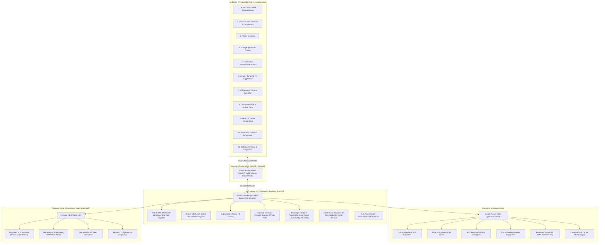

# ApplyPilot — Autonomous Career Command Center & Application Cockpit

[](https://opensource.org/licenses/MIT)
[](https://fastapi.tiangolo.com)
[](https://flutter.dev)
[](https://deepmind.google/technologies/gemini/)
[](https://firebase.google.com)
[](https://playwright.dev)
[](https://tailscale.com)
[]()

**ApplyPilot** is an autonomous, candidate-first job application cockpit designed for Android and Web with an always-on Windows PC backend. Powered by **Google Gemini 2.5 Flash** and backed by **Firebase Cloud Infrastructure**, it automates high-volume job discovery, explainable 5-factor fit scoring, ATS resume tailoring, intelligent Answer Bank recall, and ATS form filling, while escalating to you **only** when an application genuinely requires human judgment.

---

## System Architecture



---

## Gemini 2.5 Flash Intelligence Layer

ApplyPilot integrates official Google GenAI (`google.genai`) using **Gemini 2.5 Flash** as its foundational intelligence engine with in-memory SHA-256 caching and fallback to `gemini-flash-latest`:

### 1. Job Intelligence & Skill Extraction
- Analyzes discovered job descriptions in real-time.
- Extracts mandatory vs preferred skills into clean structured tags.
- Identifies experience brackets, location constraints, and salary ranges.
- Runs automated **Scam & Legitimacy Detection** to protect candidates against deceptive or MLM postings.

### 2. Explainable 5-Factor Fit Compatibility
- Evaluates candidate alignment across:
  1. Technical Stack (Python, ML, PyTorch, Data Engineering)
  2. Experience & Benchmark Window
  3. Academic Qualifications
  4. Location & Work Mode Preferences
  5. Compensation Expectations
- Generates transparent match percentages, strongest factors, and actionable gap bridging advice.

### 3. ATS Resume Tailoring Intelligence
- Compares job requirements against verified candidate accomplishments.
- Suggests tailored bullet point variations highlighting real research impact without fabricating facts.
- Computes ATS keyword coverage and estimated compatibility scores.

### 4. Intelligent Answer Bank Recall & Suggestions
- Suggests concise, professional answers to ATS screening questions.
- Grounded strictly in candidate proof points: **VIT Vellore Integrated MTech CSE (Data Science)**, **2 published patents** (Driver Multimodal Fusion Accident Predictor & Acoustic Doppler Session Guard), **Agentic Code Intelligence** benchmark (43-63ms CPU latency), and **AWS Solutions Architect** certification.
- **Zero Hallucination Guarantee**: Strict system boundaries prevent inventing employment history, fake degrees, or fabricated metrics.

### 5. Predictive Interview Preparation
- Predicts company-specific technical interview questions with architectural hints and model answers.
- Generates behavioral STAR (Situation, Task, Action, Result) scenario guides rooted in candidate project achievements.
- Outlines the candidate's unique edge to stand out in interviews.

### 6. Conversational AI Career Advisor
- Dedicated in-app copilot screen (`AiAssistantScreen`) with live access to system statistics (discovered jobs, active queue, daily cap, upcoming interviews).
- Interactive quick prompt pills for instant interview prep, resume strategy, and funnel analysis.

---

## Firebase Cloud Platform (`applypilot-89c65`)

The backend initializes the **Firebase Admin SDK** using the service account certificate `applypilot-89c65-firebase-adminsdk-fbsvc-01b6f0c818.json`:

1. **Firestore Cloud Replica**:
   - `POST /api/v1/firebase/sync`: Asynchronously replicates candidate profile details and discovered jobs from local SQLite to Firestore collections (`profiles`, `jobs`).
2. **Firebase Cloud Messaging (FCM)**:
   - `POST /api/v1/firebase/test-notification`: Dispatches push alerts to Android devices on topic `applypilot_alerts` for high-priority events (pending "Needs You" questions, scheduled interviews, daily cap reached).
3. **Firebase Auth Token Verification**:
   - `POST /api/v1/firebase/verify-token`: Cryptographically verifies client-side Firebase Auth ID tokens for secure mobile access.
4. **Remote Config & Diagnostics**:
   - `GET /api/v1/firebase/status` & `GET /api/v1/firebase/config`: Real-time health monitoring of Firestore, messaging, and operational feature flags.

---

## Unslopped Editorial Design System

- **Primary Identity**: Warm Ivory (`#FAFAF7`), British Racing Green (`#1B4332`), Pure White surfaces (`#FFFFFF`), and Muted Brass accents (`#C5A880` / `#D4AF37`).
- **Obsidian Dark Mode**: Deep Forest Slate (`#0D1912`, `#14251B`) with vibrant green glows (`#40916C`) and hairline border separation (`#253F30`).
- **Semantic Color Matrix**:
  - **Emerald** (`#2D6A4F` / `#52B788`): Successful applications & positive progress.
  - **Blue** (`#1D4E89` / `#4895EF`): Job discovery & primary information.
  - **Violet** (`#6A4C93` / `#9D4EDD`): AI operations & resume intelligence.
  - **Amber** (`#D4A373` / `#F4A261`): Pending approvals & attention required.
  - **Coral** (`#E76F51` / `#E63946`): Errors, failed applications & warnings.
  - **Teal** (`#0081A7` / `#2A9D8F`): Interviews & career milestones.
- **Strict 4-pt Spacing Grid**: `s2` (2dp), `s4` (4dp), `s6` (6dp), `s8` (8dp), `s12` (12dp), `s16` (16dp), `s20` (20dp), `s24` (24dp), `s32` (32dp).
- **Haptic Feedback & Accessibility**: Subtle sensory feedback on every meaningful action, high-contrast typography, and 48dp touch targets.

---

## Smart Widgets & Interactive Analytics

### 8 Modular Smart Widgets (Dashboard)
1. **Application Goal Widget**: Daily/weekly targets, circular completion meter, remaining countdown.
2. **Interview Countdown Widget**: Next interview date/time, company & role details, one-tap prep sheet.
3. **Top Job Match Widget**: Single highest fit role, match badge, 3 key matching factors, 1-tap review.
4. **Needs Attention Widget**: High-priority alert banner grouping blocker questions and profile gaps.
5. **Career Streak Widget**: Consecutive search days, weekly consistency dots (M-T-W-T-F-S-S).
6. **Backend Health Widget**: Tailscale connection latency, service uptime, safe-mode status.
7. **Application Funnel Widget**: Step-down pipeline tracking pass-through rates and drop-offs.
8. **Quick Actions Widget**: Find Jobs, Tailor CV, Review Queue, Update Answer Bank, Pause/Resume.

### 7 Interactive Charts (`CustomPainter`)
1. **Weekly & Monthly Bar Chart**: 7-day velocity and 4-week volume bar graph with interactive tooltip touch points.
2. **Application Conversion Funnel**: Step-down stage visualization (`Discovered` &rarr; `Evaluated` &rarr; `Approved` &rarr; `Submitted` &rarr; `Interview` &rarr; `Offers`).
3. **Status Distribution Donut**: Concentric multi-colored arcs representing live status breakdown.
4. **Match Score Histogram**: Frequency distribution across 4 score brackets.
5. **Weekly Activity Curve**: Smooth cubic Bezier line chart with area gradient fill.
6. **Company Application Density**: Ranked horizontal bar breakdown of top target companies.
7. **Resume Version Comparison**: Compares master vs tailored resumes on ATS scores and interview conversion.

---

## Verification & Test Results

```
============================= test session starts =============================
platform win32 -- Python 3.13.0, pytest-9.1.1 -- FastAPI 0.115.8
collected 44 items

backend/tests/test_gemini_firebase.py::test_firebase_service_status PASSED      [  2%]
backend/tests/test_gemini_firebase.py::test_firebase_remote_config PASSED       [  4%]
backend/tests/test_gemini_firebase.py::test_firebase_push_notification_dispatch PASSED [  6%]
backend/tests/test_gemini_firebase.py::test_gemini_service_status PASSED        [  9%]
backend/tests/test_gemini_firebase.py::test_gemini_job_intelligence PASSED      [ 11%]
backend/tests/test_gemini_firebase.py::test_gemini_calculate_compatibility PASSED [ 13%]
backend/tests/test_gemini_firebase.py::test_gemini_tailor_resume PASSED         [ 15%]
backend/tests/test_gemini_firebase.py::test_gemini_suggest_form_answer PASSED   [ 18%]
backend/tests/test_gemini_firebase.py::test_gemini_interview_prep PASSED        [ 20%]
backend/tests/test_gemini_firebase.py::test_api_ai_status_endpoint PASSED       [ 22%]
backend/tests/test_gemini_firebase.py::test_api_ai_chat_endpoint PASSED         [ 25%]
backend/tests/test_gemini_firebase.py::test_api_firebase_status_endpoint PASSED [ 27%]
backend/tests/test_gemini_firebase.py::test_api_firebase_config_endpoint PASSED [ 29%]
backend/tests/test_phase1.py (6 tests) PASSED                                   [ 43%]
backend/tests/test_phase3.py (5 tests) PASSED                                   [ 54%]
backend/tests/test_phase4.py (3 tests) PASSED                                   [ 61%]
backend/tests/test_phase5.py (2 tests) PASSED                                   [ 65%]
backend/tests/test_phase6.py (3 tests) PASSED                                   [ 72%]
backend/tests/test_phase7_50_jobs.py (1 test) PASSED                            [ 75%]
backend/tests/test_refinement.py (5 tests) PASSED                               [ 86%]
backend/tests/test_safety_audit.py (6 tests) PASSED                             [100%]

================== 44 passed in 67.29s (100% Pass Rate) ===================
```

### Flutter Test Suite
```
00:00 +0: ApplyPilotApp boots to MainNavigationShell when onboarding is complete
00:01 +1: ApplyPilotApp boots to OnboardingScreen when onboarding is false
00:01 +2: AppTheme defines British Racing Green and Obsidian Dark themes
00:01 +3: ApplicationGoalWidget and StatusDonutChart render accurately
00:01 +4: AiAssistantScreen renders career advisor header and quick prompts
00:01 +5: All tests passed!
```

---

## Release Artifacts

The production release artifact is compiled and verified:

- **File**: `output/ApplyPilot.apk`
- **Version**: `1.3.1` (Build 5)
- **Size**: `54.3 MB` (54,329,878 bytes)
- **SHA-256**: `62A0570CFAE133EBE8BDE317AF020B7E6DE5C19939C04CA46FCC741D760283F9`
- **Flutter Web Build**: Compiled to `app/build/web` and hosted natively at `http://localhost:8000/app/`
- **Metadata**: Verified in `output/ApplyPilot-release-info.json`

---

## Getting Started

### 1. Start Windows Host Backend
```powershell
python -m uvicorn backend.app.main:app --host 0.0.0.0 --port 8000
```

### 2. Connect Mobile App Over Tailscale
1. Install `output/ApplyPilot.apk` on your Android device.
2. Enter your Windows host Tailscale IP (e.g. `http://100.x.y.z:8000`).
3. Enter your bearer token: `mApIGVEyORqpXbJzPhrhLPk9pRaS_vPOFyxH07nuPV4`.
4. Tap **Verify Connection** and start your automated career cockpit!
