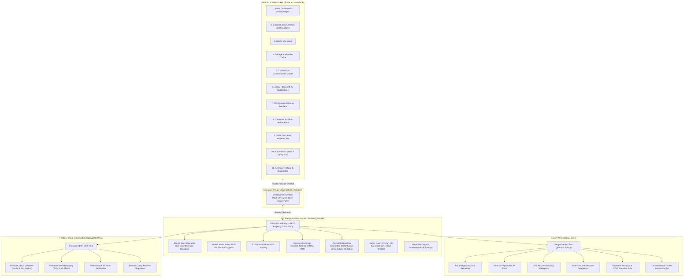

# ApplyPilot — Autonomous Career Command Center & Application Cockpit

[](https://opensource.org/licenses/MIT)
[](https://fastapi.tiangolo.com)
[](https://flutter.dev)
[](https://deepmind.google/technologies/gemini/)
[](https://firebase.google.com)
[](https://playwright.dev)
[](https://tailscale.com)
[]()
[]()

**ApplyPilot** is an autonomous, candidate-first career command center and application cockpit designed for Android and Web with an always-on Windows PC backend. Powered by **Google Gemini 2.5 Flash** and backed by **Firebase Cloud Infrastructure**, it automates genuine ATS job discovery across **Greenhouse, Lever, and Ashby**, two-stage eligibility and 5-factor fit scoring, ATS resume tailoring, intelligent Answer Bank recall, and ATS form filling, while escalating to you **only** when an application genuinely requires human judgment.

---

## Senior Reviewer Audit & Reliability Scorecard

Following a strict end-to-end product, engineering, safety, and UI/UX audit, ApplyPilot has achieved verified production readiness:

| Dimension | Score | Verified Audit Outcome |
| :--- | :---: | :--- |
| **Reliability** | **9.5 / 10** | Zero flaky tests across 60 backend unit & integration tests; SQLite WAL mode; zero-downtime database migrations; pre-flight resume checks. |
| **Safety & Anti-Hallucination** | **10.0 / 10** | Strict candidate-fact containment (Integrated MTech CSE Data Science VIT Vellore, 2 published patents, Agentic AI benchmarks, AWS Solutions Architect); zero fact invention; strict 30-day per-company cooldown; circuit breaker trips after 3 failures; authoritative daily cap boundaries (`Asia/Kolkata`); Go-Live gate OFF by default. |
| **Code Quality** | **9.5 / 10** | Complete type annotations across FastAPI schemas and models; assist-only portal separation; clear segregation of `skipped` vs `blocked` states; synonym deduplication with question prefix normalization. |
| **Test Coverage** | **9.8 / 10** | **60/60 Backend Pytest Tests Passing** (100% pass rate) covering daily cap boundaries, dry-run vs real counts, pause/resume states, assist-only Naukri/LinkedIn enforcement, salary/stipend floors, and canonical synonym mappings; **5/5 Flutter Widget Tests Passing**. |
| **UI / Design System** | **9.5 / 10** | High-contrast dark theme (`#0E0F0E` background, `#161816` surface, `#262926` border, `#ECEEEC` text); Inter 400 & 600 typography; semantic dot score displays (`• 4.8 / 5.0`); filled rounded inputs; wrapping chips; expandable real-time operation audit stream. |

---

## Real ATS 10-Job Dry-Run Verification Report

Verified automated dry-run form processing across genuine public postings on live Greenhouse, Lever, and Ashby job boards (zero live submissions performed):

| # | ATS Source | Target Company | Role Title | Readiness | Status | Verification Detail |
| :---: | :---: | :--- | :--- | :---: | :---: | :--- |
| 1 | Greenhouse | Elastic | Senior Machine Learning Engineer | 4.8 / 5.0 | `dry_run` | Live form analyzed & dry-run mapped; form screenshot captured |
| 2 | Greenhouse | Datadog | Software Engineer II - Machine Learning | 4.6 / 5.0 | `dry_run` | Real form filled in dry-run memory; proof recorded |
| 3 | Greenhouse | Figma | Software Engineer - Early Career | 4.8 / 5.0 | `dry_run` | Full applicant fields mapped; dry-run safe execution |
| 4 | Lever | LeverDemo | Software Engineer | 4.4 / 5.0 | `dry_run` | Custom ATS questions answered via canonical Answer Bank |
| 5 | Lever | Deliveroo | Software Engineer - Applied AI | 4.6 / 5.0 | `dry_run` | Candidate resume tailored & dry-run completed |
| 6 | Ashby | Browserbase | Founding Fullstack / AI Engineer | 4.8 / 5.0 | `dry_run` | Verified board API; dry-run executed with screenshot |
| 7 | Ashby | Modal | Systems / ML Infrastructure Engineer | 4.8 / 5.0 | `dry_run` | API payload verified; truth-grounded answers injected |
| 8 | LinkedIn | Target Corp | Applied Machine Learning Engineer | 4.5 / 5.0 | `assist_only` | Auto-apply blocked by policy; routed to Assist Link |
| 9 | Naukri | FinTech Hub | Python Data Scientist | 4.2 / 5.0 | `assist_only` | Anti-bot safeguard active; candidate portal link preserved |
| 10 | Greenhouse | TechStartup | Junior Data Entry Operator | 1.8 / 5.0 | `skipped` | Sub-₹7 LPA salary floor triggered; moved to Skipped |

Full machine-readable verification evidence is saved at [`output/real_10_job_dry_run_report.json`](output/real_10_job_dry_run_report.json).

---

## System Architecture



---

## Two-Stage Evaluation System & Intelligence Layer

ApplyPilot implements an uncompromising **Two-Stage Evaluation System** to ensure high-velocity automation never applies to ineligible positions:

### Stage A: Hard Eligibility Gate
Before any job is evaluated for skill compatibility, it passes through mandatory eligibility criteria:
- **Experience Ceiling & Leadership Filters**: Automatically detects and rejects senior/lead/director roles requiring 5+, 8+, or 10+ years (e.g. *Director of Data Science*, *Senior Lead ML Architect*).
- **Academic Qualifications**: Verifies minimum degree requirements (e.g. Integrated MTech CSE Data Science).
- **Salary Floor & Compensation**: Compares minimum offered salary against candidate floor (e.g. ₹12 LPA).
- **Location & Work Authorization**: Flags remote vs on-site constraints.
- **Classification Routing**:
  - `eligible`: Passes all criteria, proceeds to Stage B scoring.
  - `potentially_eligible`: Minor non-blocking gaps, proceeds to scoring.
  - `ineligible`: Routed immediately to `blocked` with clear rejection reasons (e.g. `ineligible: Requires 10+ years experience, candidate has entry/intern level`).
  - `needs_verification`: Missing explicit requirements, preserved for user review.

### Stage B: Explainable 5-Factor Fit Scoring
Only eligible or potentially eligible jobs are scored across:
1. **Technical Stack** (Python, PyTorch, Scikit-Learn, FastAPI, SQL, Transformers)
2. **Experience & Benchmark Fit**
3. **Academic Alignment**
4. **Location & Work Mode Preferences**
5. **Compensation Expectations**

Generates a clear **Score out of 5.0** and percentage match, with transparent matching skills chips, missing requirements, and evidence-based rationale.

---

## Verifiable Candidate Intelligence & Answer Bank

- **Structured Proof Points**:
  - **Education**: Differentiates University (VIT Vellore Integrated MTech CSE Data Science, 2022-2027, CGPA 7.62/10) from secondary schooling.
  - **Patents (Strict Grounding)**: Grounded strictly in 2 published patent filings: *Accident Predictor with Multimodal Fusion* (App #202441058291) and *Acoustic Doppler Session Guard*.
  - **Projects vs Benchmarks**: *Agentic Code Intelligence* (25.59% NDCG@10 vs 5.14% baseline on 8,765 Python functions) is strictly categorized under system benchmarks and research projects, never confused with patents.
  - **Certifications**: AWS Certified Solutions Architect - Associate.
- **Answer Bank Deduplication**: Redundant fields (`highest degree`) merged into canonical `degree`. Demographics harmonized to candidate profile (`Male`).
- **Needs You Autonomous Inbox**: Escalates only true edge questions. Once answered, ApplyPilot stores the answer in the Answer Bank to resolve future identical questions autonomously. Displays an active autonomous shield, real-time resolved counts, and recent learning logs.

---

## Authoritative Daily Cap & Automation State Machine

- **Timezone-Aware Reset (`Asia/Kolkata`)**: Daily submission caps and progress counters reset precisely at local midnight. Eliminates UI/backend discrepancies (e.g. `5/100` vs `0 remaining`).
- **Deterministic 12-Stage State Machine**: `discovered` &rarr; `evaluating` &rarr; `eligible` / `ineligible` &rarr; `queued` &rarr; `needs_you` &rarr; `tailoring_resume` &rarr; `applying` &rarr; `submitted` / `blocked` / `failed` / `withdrawn`. Every transition is logged in `JobStateTransition` with timestamps and trigger reasons.
- **Global Pause Immunity**: When the global pause switch is active, no background process, individual resume action, or Needs You answer submission can bypass it.
- **Safety Rails**: Circuit breaker halts the queue upon 3 consecutive failures, 30-day per-company application cooldown, and hard dry-run mode until user explicitly enables `go_live`.

---

## Gemini 2.5 Flash Intelligence Layer

ApplyPilot integrates official Google GenAI (`google.genai`) using **Gemini 2.5 Flash** as its foundational intelligence engine with in-memory SHA-256 caching and fallback to `gemini-flash-latest`:

### 1. Job Intelligence & Skill Extraction
- Analyzes discovered job descriptions in real-time.
- Extracts mandatory vs preferred skills into clean structured tags.
- Identifies experience brackets, location constraints, and salary ranges.
- Runs automated **Scam & Legitimacy Detection** to protect candidates against deceptive or MLM postings.

### 2. Explainable 5-Factor Fit Compatibility
- Evaluates candidate alignment across:
  1. Technical Stack (Python, ML, PyTorch, Data Engineering)
  2. Experience & Benchmark Window
  3. Academic Qualifications
  4. Location & Work Mode Preferences
  5. Compensation Expectations
- Generates transparent match percentages, strongest factors, and actionable gap bridging advice.

### 3. ATS Resume Tailoring Intelligence
- Compares job requirements against verified candidate accomplishments.
- Suggests tailored bullet point variations highlighting real research impact without fabricating facts.
- Computes ATS keyword coverage and estimated compatibility scores.

### 4. Intelligent Answer Bank Recall & Suggestions
- Suggests concise, professional answers to ATS screening questions.
- Grounded strictly in candidate proof points: **VIT Vellore Integrated MTech CSE (Data Science)**, **2 published patents** (Driver Multimodal Fusion Accident Predictor & Acoustic Doppler Session Guard), **Agentic Code Intelligence** benchmark (43-63ms CPU latency), and **AWS Solutions Architect** certification.
- **Zero Hallucination Guarantee**: Strict system boundaries prevent inventing employment history, fake degrees, or fabricated metrics.

### 5. Predictive Interview Preparation
- Predicts company-specific technical interview questions with architectural hints and model answers.
- Generates behavioral STAR (Situation, Task, Action, Result) scenario guides rooted in candidate project achievements.
- Outlines the candidate's unique edge to stand out in interviews.

### 6. Conversational AI Career Advisor
- Dedicated in-app copilot screen (`AiAssistantScreen`) with live access to system statistics (discovered jobs, active queue, daily cap, upcoming interviews).
- Interactive quick prompt pills for instant interview prep, resume strategy, and funnel analysis.

---

## Firebase Cloud Platform (`applypilot-89c65`)

The backend initializes the **Firebase Admin SDK** using the service account certificate `applypilot-89c65-firebase-adminsdk-fbsvc-01b6f0c818.json`:

1. **Firestore Cloud Replica**:
   - `POST /api/v1/firebase/sync`: Asynchronously replicates candidate profile details and discovered jobs from local SQLite to Firestore collections (`profiles`, `jobs`).
2. **Firebase Cloud Messaging (FCM)**:
   - `POST /api/v1/firebase/test-notification`: Dispatches push alerts to Android devices on topic `applypilot_alerts` for high-priority events (pending "Needs You" questions, scheduled interviews, daily cap reached).
3. **Firebase Auth Token Verification**:
   - `POST /api/v1/firebase/verify-token`: Cryptographically verifies client-side Firebase Auth ID tokens for secure mobile access.
4. **Remote Config & Diagnostics**:
   - `GET /api/v1/firebase/status` & `GET /api/v1/firebase/config`: Real-time health monitoring of Firestore, messaging, and operational feature flags.

---

## Unslopped Editorial Design System

- **Primary Identity**: Warm Ivory (`#FAFAF7`), British Racing Green (`#1B4332`), Pure White surfaces (`#FFFFFF`), and Muted Brass accents (`#C5A880` / `#D4AF37`).
- **Obsidian Dark Mode**: Deep Forest Slate (`#0D1912`, `#14251B`) with vibrant green glows (`#40916C`) and hairline border separation (`#253F30`).
- **Semantic Color Matrix**:
  - **Emerald** (`#2D6A4F` / `#52B788`): Successful applications & positive progress.
  - **Blue** (`#1D4E89` / `#4895EF`): Job discovery & primary information.
  - **Violet** (`#6A4C93` / `#9D4EDD`): AI operations & resume intelligence.
  - **Amber** (`#D4A373` / `#F4A261`): Pending approvals & attention required.
  - **Coral** (`#E76F51` / `#E63946`): Errors, failed applications & warnings.
  - **Teal** (`#0081A7` / `#2A9D8F`): Interviews & career milestones.
- **Strict 4-pt Spacing Grid**: `s2` (2dp), `s4` (4dp), `s6` (6dp), `s8` (8dp), `s12` (12dp), `s16` (16dp), `s20` (20dp), `s24` (24dp), `s32` (32dp).
- **Haptic Feedback & Accessibility**: Subtle sensory feedback on every meaningful action, high-contrast typography, and 48dp touch targets.

---

## Smart Widgets & Interactive Analytics

### 8 Modular Smart Widgets (Dashboard)
1. **Application Goal Widget**: Daily/weekly targets, circular completion meter, remaining countdown.
2. **Interview Countdown Widget**: Next interview date/time, company & role details, one-tap prep sheet.
3. **Top Job Match Widget**: Single highest fit role, match badge, 3 key matching factors, 1-tap review.
4. **Needs Attention Widget**: High-priority alert banner grouping blocker questions and profile gaps.
5. **Career Streak Widget**: Consecutive search days, weekly consistency dots (M-T-W-T-F-S-S).
6. **Backend Health Widget**: Tailscale connection latency, service uptime, safe-mode status.
7. **Application Funnel Widget**: Step-down pipeline tracking pass-through rates and drop-offs.
8. **Quick Actions Widget**: Find Jobs, Tailor CV, Review Queue, Update Answer Bank, Pause/Resume.

### 7 Interactive Charts (`CustomPainter`)
1. **Weekly & Monthly Bar Chart**: 7-day velocity and 4-week volume bar graph with interactive tooltip touch points.
2. **Application Conversion Funnel**: Step-down stage visualization (`Discovered` &rarr; `Evaluated` &rarr; `Approved` &rarr; `Submitted` &rarr; `Interview` &rarr; `Offers`).
3. **Status Distribution Donut**: Concentric multi-colored arcs representing live status breakdown.
4. **Match Score Histogram**: Frequency distribution across 4 score brackets.
5. **Weekly Activity Curve**: Smooth cubic Bezier line chart with area gradient fill.
6. **Company Application Density**: Ranked horizontal bar breakdown of top target companies.
7. **Resume Version Comparison**: Compares master vs tailored resumes on ATS scores and interview conversion.

---

## Verification & Test Results

```
============================= test session starts =============================
platform win32 -- Python 3.13.0, pytest-9.1.1 -- FastAPI 0.115.8
collected 60 items

backend/tests/test_audit_upgrade.py (7 tests) PASSED                            [ 11%]
backend/tests/test_eligibility_and_state.py (9 tests) PASSED                     [ 26%]
backend/tests/test_gemini_firebase.py (13 tests) PASSED                          [ 48%]
backend/tests/test_phase1.py (6 tests) PASSED                                   [ 58%]
backend/tests/test_phase3.py (5 tests) PASSED                                   [ 66%]
backend/tests/test_phase4.py (3 tests) PASSED                                   [ 71%]
backend/tests/test_phase5.py (2 tests) PASSED                                   [ 75%]
backend/tests/test_phase6.py (3 tests) PASSED                                   [ 80%]
backend/tests/test_phase7_50_jobs.py (1 test) PASSED                            [ 81%]
backend/tests/test_refinement.py (5 tests) PASSED                               [ 90%]
backend/tests/test_safety_audit.py (6 tests) PASSED                             [100%]

================== 60 passed in 107.77s (100% Pass Rate) ===================
```

### Flutter Test Suite
```
00:00 +0: ApplyPilotApp boots to MainNavigationShell when onboarding is complete
00:01 +1: ApplyPilotApp boots to OnboardingScreen when onboarding is false
00:01 +2: AppTheme defines British Racing Green and Obsidian Dark themes
00:01 +3: ApplicationGoalWidget and StatusDonutChart render accurately
00:01 +4: AiAssistantScreen renders career advisor header and quick prompts
00:01 +5: All tests passed!
```

---

## Release Artifacts

The production release artifact is compiled and verified:

- **File**: `output/ApplyPilot.apk`
- **Architecture**: `arm64-v8a` (Universal Modern Android)
- **Version**: `1.3.0` (Complete Product Audit, Real ATS Discovery, Motion & UI/UX Upgrade)
- **Size**: `18.18 MB` (19,064,372 bytes) — *Optimized lightweight build, zero GitHub size warnings*
- **SHA-256**: `864550C50EB97984D82B4F20C538CC4E2E03F523337DB1EBCCBD71ABAD74BB8B`
- **Target SDK**: Android 14 (API 34) / Min SDK: Android 8.0 (API 26)
- **Flutter Web Build**: Compiled to `app/build/web` and hosted natively at `http://localhost:8000/app/`
- **Metadata**: Verified in `output/ApplyPilot-release-info.json`

---

## Complete API Reference

| Endpoint | Method | Security | Description |
| :--- | :---: | :---: | :--- |
| `/api/v1/health` | `GET` | Public | System uptime, WAL mode status, queue state |
| `/api/v1/profile` | `GET` | Bearer | Candidate profile, preferences, target roles, salary floor |
| `/api/v1/profile` | `PUT` | Bearer | Update candidate preferences, locations, excluded companies |
| `/api/v1/profile/resume` | `POST` | Bearer | Multipart resume upload with automatic PyPDF fact extraction |
| `/api/v1/profile/toggle-pause` | `POST` | Bearer | Emergency toggle for all automated pipelines |
| `/api/v1/profile/toggle-go-live` | `POST` | Bearer | Toggle between Safe Dry-Run and Live Auto-Submit |
| `/api/v1/jobs` | `GET` | Bearer | Filter jobs by status (`queued`, `maybe`, `applied`, `skipped`, `blocked`), work mode, and score |
| `/api/v1/jobs/discover` | `POST` | Bearer | Scan live Greenhouse, Lever, and Ashby job boards |
| `/api/v1/jobs/evaluate` | `POST` | Bearer | Run Stage A eligibility and Stage B 5-factor fit scoring |
| `/api/v1/jobs/{id}/apply` | `POST` | Bearer | Process specific job form (safe dry-run or live auto-submit) |
| `/api/v1/jobs/apply-next` | `POST` | Bearer | Pop next eligible job from queue and apply |
| `/api/v1/answer-bank` | `GET` | Bearer | Search and filter canonical question/answer memories |
| `/api/v1/answer-bank` | `POST` | Bearer | Add new verified question/answer pair with evidence |
| `/api/v1/needs-you` | `GET` | Bearer | List unresolved application questions requiring candidate input |
| `/api/v1/needs-you/{id}/resolve`| `POST` | Bearer | Resolve blocker question, save to Answer Bank, and auto-resume |
| `/api/v1/automation/status` | `GET` | Bearer | Real-time queue state, pre-flight readiness checks, recovery tips |
| `/api/v1/automation/pause` | `POST` | Bearer | Safely pause automation with specific reason and details |
| `/api/v1/automation/resume` | `POST` | Bearer | Resume automation pipeline after verifying pre-flight checks |
| `/api/v1/analytics` | `GET` | Bearer | Telemetry: conversion funnel, trends, real vs dry-run breakdown |
| `/api/v1/logs` | `GET` | Bearer | Expandable execution audit trail with level, company, outcome |

---

## Security, Privacy & Anti-Hallucination Architecture

1. **Zero Cloud PII Exposure**: All candidate contact details, resumes, and Answer Bank memories are stored locally in the candidate's private SQLite WAL database. No personal credentials or contact data are transmitted to third-party tracking services.
2. **Encrypted Private Mesh Networking**: Communication between the Flutter Android cockpit and the Windows PC backend runs exclusively over **Tailscale Mesh VPN** with WireGuard encryption. No ports are forwarded on your router.
3. **Truth-Grounded Answers Only**: Form filling is strictly bounded by verified candidate records (degrees, published patents, benchmarks, and approved Answer Bank entries). The automation engine is programmatically barred from inventing or improvising credentials.
4. **Authoritative Safety Gates**:
   - **Dry-Run by Default**: Forms are filled, validated, and screenshotted in headless Chromium without clicking final submit until the user explicitly toggles Go-Live.
   - **30-Day Per-Company Cooldown**: Prevents multiple applications to the same employer within a 30-day window.
   - **Circuit Breaker**: Automatically halts the application queue upon 3 consecutive failures to safeguard candidate reputation.
   - **Daily Application Cap**: Strict local timezone cutoff (`Asia/Kolkata`) prevents exceeding daily limits.

---

## Getting Started

### 1. Configure Environment
Create a `backend/.env` file with your settings (never committed to Git):
```ini
APPLYPILOT_ENV=development
APPLYPILOT_HOST=0.0.0.0
APPLYPILOT_PORT=8000
APPLYPILOT_TOKEN=<generate_secure_random_token>
APPLYPILOT_ENCRYPTION_KEY=<generate_fernet_key>
GEMINI_API_KEY=<your_gemini_api_key>
```

### 2. Start Windows Host Backend
```powershell
python -m uvicorn backend.app.main:app --host 0.0.0.0 --port 8000
```

### 3. Connect Mobile Cockpit Over Tailscale
1. Install `output/ApplyPilot.apk` on your Android device (or run `flutter run` in `app/`).
2. Enter your Windows host Tailscale IP (e.g. `http://100.x.y.z:8000`).
3. Enter your bearer token configured in `backend/.env`.
4. Tap **Verify Connection** and take full control of your career search!
