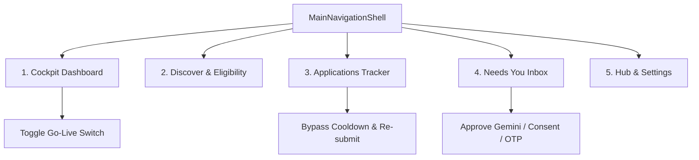

# ApplyPilot UI Design Specification & Design System (`docs/APPLYPILOT_UI_DESIGN_SPEC.md`)

> **Version:** 2.0.0  
> **Target Platforms:** Flutter (Android / iOS / Web / Desktop)  
> **Design Tools Handoff:** Google Stitch (`stitch.withgoogle.com`), Figma, Claude / v0, Antigravity Agentic IDE  
> **Architecture:** Single-source design tokens, responsive breakpoints, adaptive executive dark theme.

---

## 1. Executive Design Philosophy & Aesthetic

ApplyPilot is designed as an **Executive Flight Deck & AI Operations Cockpit** for high-volume, precision job applications. Rather than feeling like a generic job board, it conveys the feel of an **aviation instrumentation console** combined with **luxury editorial typography**.

### Core Tenets:
1. **Instrument-Grade Precision:** Every metric, connection state, and application pipeline step has a deterministic status indicator (Live, Safe Mode, Paused, Assist-Only, Needs Review).
2. **Safety First (Zero Hallucination UI):** Crucial safeguards (such as the "Go Live" autonomous switch, unconfirmed candidate facts, and legal consent checkboxes) are visually distinct, impossible to trigger accidentally, and prominently labeled.
3. **Deep Editorial Dark Theme:** Inspired by British Racing Green, obsidian graphite, warm ivory, and muted brass accents, avoiding harsh neon tones while preserving high accessibility contrast.
4. **Adaptive Responsive Grid:** Automatically shifts from a sleek single-column mobile view on Android/iOS to a dual-pane executive workstation on tablet and desktop.

---

## 2. Color Palette & Design Tokens

### 2.1 Surfaces & Canvas (Dark Mode - Primary)
| Token Name | Hex Code | Purpose / Usage |
| :--- | :---: | :--- |
| `TemplateTokens.background` | `#0E0F0E` | Main app background canvas (deep obsidian) |
| `TemplateTokens.surface` | `#161816` | Standard container / card surface |
| `TemplateTokens.surfaceElevated` | `#1E211E` | Floating modals, bottom sheets, active cards |
| `TemplateTokens.surfaceSubtle` | `#121412` | Inset code blocks, background pill tracks |
| `TemplateTokens.border` | `#262926` | 1px subtle card borders and dividers |
| `TemplateTokens.borderHover` | `#383D38` | Interactive state hover / focus border |

### 2.2 Editorial Signature Palette
| Token Name | Hex Code | Purpose / Usage |
| :--- | :---: | :--- |
| `AppColors.racingGreen` | `#1B4332` | Signature British Racing Green brand accent |
| `AppColors.accent` (Jade) | `#7FD1A8` | Primary active accent, toggles, success state |
| `AppColors.accentSubtle` | `rgba(127, 209, 168, 0.12)` | Badge backgrounds, highlighted table rows |
| `AppColors.brass` | `#D4AF37` | Luxury brass accent, high-value jobs, certifications |
| `AppColors.warmIvory` | `#FAFAF7` | Light-mode canvas & high-contrast typography |

### 2.3 Semantic Status & Utility Colors
| Status Token | Dark Hex | Light Hex | Meaning |
| :--- | :---: | :---: | :--- |
| **Success / Submitted** | `#7FD1A8` | `#2D6A4F` | Submitted application, verified proof, OTP approved |
| **Warning / Needs Review**| `#FBBF24` | `#D4A373` | Pending human action, unreviewed live submission |
| **Error / Blocked** | `#F87171` | `#E76F51` | Grounding failure, failed ATS request, circuit breaker |
| **Info / Discovery** | `#38BDF8` | `#1D4E89` | Tailored draft ready, job discovered, Tailscale online |
| **AI / Gemini Intelligence**| `#A78BFA` | `#6A4C93` | Gemini auto-answer, confidence score, AST embedding |
| **Assist-Only** | `#60A5FA` | `#1D4E89` | LinkedIn / Indeed / Workday assist-only job cards |

---

## 3. Typography Scale & Hierarchy

ApplyPilot uses a clean sans-serif system font stack (`Inter`, `SF Pro Display`, `Roboto`), with strict typographic weights for information hierarchy.

| Style Role | Font Size | Line Height | Weight | Color (Dark) | Usage |
| :--- | :---: | :---: | :---: | :---: | :--- |
| **Display Header** | `26px` | `32px` | `700` (Bold) | `#ECEEEC` | Cockpit title, profile candidate name |
| **Section Title** | `18px` | `24px` | `600` (SemiBold) | `#ECEEEC` | Card group titles ("Needs You Inbox", "Pipeline") |
| **Card Header** | `15px` | `20px` | `600` (SemiBold) | `#ECEEEC` | Job titles, metric labels, question titles |
| **Body Primary** | `13px` | `18px` | `400` (Regular) | `#ECEEEC` | Job description excerpts, answer texts, logs |
| **Body Secondary** | `12px` | `16px` | `400` (Regular) | `#A0A69F` | Company names, locations, timestamps, cited facts |
| **Caption / Monospace**| `11px` | `14px` | `500` (Mono/Medium)| `#6B726A` | API endpoints, Tailscale IP, OTP countdown, SHA |
| **Badge / Tag** | `10px` | `12px` | `700` (Bold) | `#7FD1A8` | Status chips ("SAFE MODE", "ASSIST-ONLY", "GREENHOUSE") |

---

## 4. Spacing, Radii & Grid System

- **Base Grid:** 4pt / 8pt grid system.
- **Spacing Scale:**
  - `s2` (2px), `s4` (4px), `s8` (8px), `s12` (12px), `s16` (16px), `s20` (20px), `s24` (24px), `s32` (32px).
- **Border Radii:**
  - `radiusSm` (`6px`): Small badges, code chips, tooltips.
  - `radiusMd` (`10px`): Form input fields, dropdowns, inner sub-cards.
  - `radiusLg` (`14px`): Main cards (`ShadcnCard`, `KiteStatCard`), dialogs.
  - `radiusXl` (`20px`): Bottom sheet modals, floating action bars.
  - `radiusPill` (`999px`): Status tags, filter chips, action pills.
- **Responsive Breakpoints:**
  - **Mobile:** `< 650px` (Single column vertical flow, bottom navigation bar).
  - **Tablet:** `650px - 950px` (2-column grid, compact drawer).
  - **Desktop:** `> 950px` (Executive dual-pane flight deck: 60% Left column pipeline, 40% Right column logs/stats).

---

## 5. Core Reusable Component Library

```
┌────────────────────────────────────────────────────────────────────────┐
│                        KiteAppShell (Layout)                           │
│  ┌────────────────────────┐  ┌──────────────────────────────────────┐  │
│  │ Adaptive Nav Bar / Rail │  │ Active Screen View Content Area      │  │
│  │ Dashboard Discover ... │  │ (KiteStatCard, ShadcnCard, Feeds...) │  │
│  └────────────────────────┘  └──────────────────────────────────────┘  │
└────────────────────────────────────────────────────────────────────────┘
```

### 5.1 `KiteStatCard` (Executive KPI Tile)
- **Container:** `surface` background, `border` 1px outline, `14px` border radius.
- **Top Row:** Title (`12px` muted text) + semantic icon (`16px`).
- **Middle Row:** Large metric value (`24px` bold, e.g. `"24"`, `"88.4%"`).
- **Bottom Row:** Sparkline trend or delta pill (`"▲ 4 today"`, green subtle background).

### 5.2 `ShadcnCard` (Content Container)
- **Border:** 1px `#262926` with hover tint `#383D38`.
- **Background:** Inset gradient or flat `#161816`.
- **Padding:** 16px standard, 20px on desktop.

### 5.3 `ShadcnBadge` (Semantic Status Tag)
- **Geometry:** Height 22px, border-radius `999px` (pill), horizontal padding 8px.
- **Typography:** `10px` bold, uppercase, letter-spacing `0.5px`.
- **Variants:**
  - `Live`: Emerald `#7FD1A8` text on `rgba(127, 209, 168, 0.12)` bg.
  - `Safe Mode`: Amber `#FBBF24` text on `rgba(251, 191, 36, 0.12)` bg.
  - `Assist-Only`: Sky Blue `#38BDF8` text on `rgba(56, 189, 248, 0.12)` bg.
  - `Needs Review`: Coral `#F87171` text on `rgba(248, 113, 113, 0.12)` bg.

### 5.4 `InteractiveCharts` (Conversion & Pipeline Visualization)
- **Success Funnel:** Stacked bar chart showing Discovered ➔ Screened ➔ Tailored ➔ Submitted.
- **Salary Distribution:** Horizontal range bar displaying ₹7 LPA cutoff vs upper quartile.

---

## 6. Screen-by-Screen UI Specification



---

### Screen 1: Cockpit & Automation Control (`HomeScreen.dart`)

**Goal:** Provide full real-time awareness of the autonomous worker, safety status, and active pipeline.

```
┌──────────────────────────────────────────────────────────────────────┐
│ ● Tailscale & FastAPI Connected (Port 8000)      [Today | Week | All]│
├──────────────────────────────────────────────────────────────────────┤
│ 🛡️ SAFE MODE: DRY RUN ONLY                             [ GO LIVE ⭘ ] │
│ Live submission is disabled. Applications are verified without submit│
├──────────────────────────────────────────────────────────────────────┤
│ ┌───────────────┐ ┌───────────────┐ ┌───────────────┐ ┌────────────┐ │
│ │ Queued Jobs   │ │ Assist Drafts │ │ Needs You     │ │ Submitted  │ │
│ │      18       │ │       7       │ │     2 !       │ │     4      │ │
│ └───────────────┘ └───────────────┘ └───────────────┘ └────────────┘ │
├──────────────────────────────────────────────────────────────────────┤
│ ACTIVE PIPELINE: Figma - Machine Learning Engineer                    │
│ [Greenhouse ATS] • [Tailoring Resume...] ===================> [70%]  │
├──────────────────────────────────────────────────────────────────────┤
│ [ ▶ Apply Next Job ]    [ ⏸ Pause Engine ]    [ ⚡ Trigger Scrape ]   │
├──────────────────────────────────────────────────────────────────────┤
│ LIVE RUN LOGS:                                                       │
│ 13:04:12 [OK] Job 159 Grounded verification passed (0 fake claims)   │
│ 13:04:08 [AI] Gemini answered "Experience with PyTorch" (Conf: 0.94) │
└──────────────────────────────────────────────────────────────────────┘
```

#### Detailed Layout Components:
1. **Connectivity Status Bar:**
   - Left: Green pulsing dot + `"FastAPI & Tailscale Connected (Port 8000)"`.
   - Right: Last synced timestamp (`13:04:12`) + Date filter pill (`Today`, `Week`, `All`).
2. **Go-Live Safeguard Hero Card:**
   - Amber alert border (`#FBBF24`) when `go_live = False` (Safe Mode).
   - Emerald border (`#7FD1A8`) with soft breathing glow when `go_live = True` (Live Apply Active).
   - Prominent toggle switch with double-confirmation dialog if flipped to Live.
3. **KPI Metrics Grid (4 Cards):**
   - Active Queue Count, Assist-Only Drafts, Pending Needs You Items, Total Submitted.
4. **Active Application Pipeline Card:**
   - Shows current job in flight, company logo avatar, target role, ATS provider badge.
   - 4-step progress stepper: Discovery ➔ Grounded Tailoring ➔ Pre-fill ➔ Ready/Submitted.
5. **Console Log Feed:**
   - Monospace typography (`11px`), color-coded tags (`[OK]` green, `[AI]` purple, `[WARN]` amber).
   - Tap to expand full JSON execution trace.

---

### Screen 2: Needs You (Decision Triage Inbox) (`NeedsYouScreen.dart`)

**Goal:** Route questions requiring candidate input or consent with zero friction.

```
┌──────────────────────────────────────────────────────────────────────┐
│  NEEDS YOU INBOX (2 Pending Actions)                     [Filter ▾]  │
├──────────────────────────────────────────────────────────────────────┤
│ ⚠️ LEGAL CONSENT REQUIRED                           Company: Spotify  │
│ "Do you consent to automated background checks and data processing?" │
│ [ ] I agree to the data processing terms                             │
│                                           [ REJECT ]  [ APPROVE & TICK]│
├──────────────────────────────────────────────────────────────────────┤
│ 🤖 GEMINI AUTO-ANSWER PROPOSAL (Confidence: 92%)    Company: GitLab   │
│ Question: "Describe your experience with AST parsing and BM25."      │
│ ┌──────────────────────────────────────────────────────────────────┐ │
│ │ Proposed: "In my Code Retrieval Engine research, I combined  │ │
│ │ BM25, AST analysis, and code embeddings across 5,000 Python..."  │ │
│ └──────────────────────────────────────────────────────────────────┘ │
│ Facts Cited: [Code Retrieval Engine Research - Example Institute]      │
│                                           [ EDIT ]    [ APPROVE ]    │
├──────────────────────────────────────────────────────────────────────┤
│ 🔐 GREENHOUSE EMAIL OTP CODE                        Company: Cloudflare
│ Enter 6-digit code sent to alex.morgan@example.com              │
│ [ 7 ] [ 9 ] [ 8 ] [ 2 ] [ 9 ] [ 4 ]             Auto-sync: 12s...   │
│                                           [ SUBMIT CODE ]            │
└──────────────────────────────────────────────────────────────────────┘
```

#### Card Types:
1. **Category A: Legal & Consent Checkbox:**
   - Red/Coral warning badge: `"Requires Human Consent"`.
   - Interactive checkbox with full question text and company privacy link.
   - Primary action: `"Approve & Tick"`.
2. **Category B: Gemini Auto-Answer Review:**
   - Purple AI badge with confidence meter (`92%`).
   - Quote box with proposed first-person answer.
   - Pill chips showing cited facts from `facts.py`.
   - Actions: `"Edit Answer"` (opens text sheet) and `"Approve & Save to Bank"`.
3. **Category C: ATS Verification OTP:**
   - 6 individual PIN entry boxes.
   - Live countdown displaying background Gmail API auto-fetch status.

---

### Screen 3: Job Discovery & Eligibility Queue (`DiscoverScreen.dart`)

**Goal:** Display scraped and discovered positions filtered through strict eligibility criteria.

```
┌──────────────────────────────────────────────────────────────────────┐
│ [ 🔍 Search Python, ML, Data Science... ]                 [ ⚙️ Filter ]│
│ [ All (18) ]  [ Greenhouse (8) ]  [ Lever (5) ]  [ Assist-Only (5) ] │
├──────────────────────────────────────────────────────────────────────┤
│ ┌──────────────────────────────────────────────────────────────────┐ │
│ │ [GitLab Logo]  Backend Engineer (Python), AI       ₹14-18 LPA    │ │
│ │ GitLab • Remote (India) • Full-Time               [GREENHOUSE]   │ │
│ │ ✓ Seniority: Fresher / 0-2 yrs  •  ✓ Min ₹7 LPA threshold        │ │
│ │                                                                  │ │
│ │ [ 📄 Tailor Resume ]       [ 👁️ Preview ]       [ ➕ Add to Queue ]│ │
│ └──────────────────────────────────────────────────────────────────┘ │
│ ┌──────────────────────────────────────────────────────────────────┐ │
│ │ [LinkedIn Logo] Associate AI Engineer              Unlisted Pay  │ │
│ │ Microsoft • Bengaluru, India • Full-Time          [ASSIST-ONLY]  │ │
│ │ ℹ️ Requires manual submission via LinkedIn Easy Apply            │ │
│ │                                                                  │ │
│ │ [ ✍️ Pre-fill Draft ]                           [ ↗ Open Link ]   │ │
│ └──────────────────────────────────────────────────────────────────┘ │
└──────────────────────────────────────────────────────────────────────┘
```

#### Eligibility Visual Guards:
- **Seniority Shield:** Green checkmark if 0-2 years, automatically hidden/blocked if 3+ years or containing `Senior`, `Lead`, `Manager`.
- **Compensation Tag:** Emerald tag if listed pay `≥ ₹7 LPA`. Amber tag if unlisted at verified company.
- **Assist-Only Banner:** Prominently badges LinkedIn Easy Apply, Indeed, and Workday as "Assist-Only" with disabled auto-submit buttons.

---

### Screen 4: Application Tracker & Audit Timeline (`ApplicationTrackerScreen.dart`)

**Goal:** End-to-end audit trail of every job processed, past submissions, and cooldown controls.

```
┌──────────────────────────────────────────────────────────────────────┐
│ PIPELINE TRACKER                                                     │
│ [ All (32) ]  [ Queued (18) ]  [ Needs Review (4) ]  [ Submitted (10)]│
├──────────────────────────────────────────────────────────────────────┤
│ Cloudflare - AI Security Research & Red Team Engineer                │
│ Status: [ ⚠️ NEEDS REVIEW ]                        Applied: Nov 17   │
│ Cooldown: Active (29 days remaining)                                 │
│                                                                      │
│ ┌─ Timeline ───────────────────────────────────────────────────────┐ │
│ │ ● Discovered via Ashby API                          Nov 17 07:12 │ │
│ │ ● Grounded Resume Generated (10pt clean spacing)    Nov 17 07:14 │ │
│ │ ● Greenhouse OTP Verified (79829436)                Nov 17 07:22 │ │
│ │ ◯ Awaiting User Review Against New Eligibility      Nov 17 07:30 │ │
│ └──────────────────────────────────────────────────────────────────┘ │
│ [ 📄 View Grounded Resume ]     [ 🔄 Re-Submit Override (Bypass CD) ]│
└──────────────────────────────────────────────────────────────────────┘
```

#### Cooldown & Resubmit Features:
- **Cooldown Pill:** Shows remaining cooldown days to prevent spamming ATS systems.
- **Manual Bypass Button:** `"Re-Submit Override"` allows candidate to bypass cooldown for that single job when a corrected resume has been generated.
- **Proof Drawer:** Sliding bottom sheet displaying the actual screenshot captured by Playwright at the moment of submission.

---

### Screen 5: Profile & Locked Source of Truth (`ProfileScreen.dart`)

**Goal:** Candidate credentials portal. Clearly separates locked facts from candidate-configurable preferences.

```
┌──────────────────────────────────────────────────────────────────────┐
│  Alex Morgan                                  [ Verified Profile]│
│  MTech Integrated CSE (Data Science) • Example Institute                   │
│  [ alex.morgan@example.com ]  [ LinkedIn ]  [ GitHub ]          │
├──────────────────────────────────────────────────────────────────────┤
│ 🔒 LOCKED FACTS (Read-Only Single Source of Truth)                   │
│ • Education: MTech Integrated CSE, Example Institute (Started Sep 2022)    │
│ • CGPA: 8.10 / 10.00                                                 │
│ • Patents (2 Registered):                                            │
│   1. A Low-Power Soil Moisture Controller...│
│   2. Ultrasonic Presence Verification for Secure Sessions                                  │
│ • Flagship Project: Code Retrieval Engine                        │
│   (embeddings + BM25 + AST; 10,000 Python programs; 18% NDCG@10)  │
│ • Certifications: AWS Cloud Solutions Architect, Generative AI...    │
├──────────────────────────────────────────────────────────────────────┤
│ ⚙️ CANDIDATE PREFERENCES (Requires Your Input)                       │
│ Expected Graduation: [ Expected May 2027             ] [ Confirm ]   │
│ Notice Period:       [ Immediate / 15 Days           ] [ Confirm ]   │
│ Work Authorization:  [ Authorized to work in India   ] [ Confirm ]   │
│ Relocation:          [ Open to Remote & Major Metros ] [ Confirm ]   │
└──────────────────────────────────────────────────────────────────────┘
```

---

### Screen 6: Settings & Security Console (`SettingsScreen.dart`)

**Goal:** Network binding, security tokens, Gemini auto-answer configuration, and circuit breakers.

```
┌──────────────────────────────────────────────────────────────────────┐
│  SETTINGS & SECURITY                                                 │
├──────────────────────────────────────────────────────────────────────┤
│ NETWORK & ACCESS CONTROL                                             │
│ Host Interface: Localhost & Tailscale Only (100.64.0.0/10)   [ ACTIVE ]│
│ Access Token:   <your-token>                   [ COPY ] │
├──────────────────────────────────────────────────────────────────────┤
│ GEMINI AUTO-ANSWER CONFIGURATION                                     │
│ Enabled:        [ ON ⬤ ]                                             │
│ Model:          gemini-2.5-flash                             [ Dropdown ]
│ Confidence Cut: [ 85% ] (Answers <85% route to Needs You)    [ Slider ]
├──────────────────────────────────────────────────────────────────────┤
│ CIRCUIT BREAKERS & SAFETY GAUGES                                     │
│ Application Breaker: 0 / 3 failures (Pauses entire app on 3) [ NORMAL ]
│ Gemini Breaker:      0 / 5 failures (Pauses Gemini only)     [ NORMAL ]
├──────────────────────────────────────────────────────────────────────┤
│ DAILY APPLICATION LIMITS                                             │
│ Target Limit:   [ 15 applications / day ]                            │
│ Throttle Delay: [ 180 seconds between submissions ]                  │
└──────────────────────────────────────────────────────────────────────┘
```

---

## 7. Interaction States & Transitions

### 7.1 Haptic Feedback Strategy
- **Light Impact:** Bottom tab switching, filter chips selection, expanding logs.
- **Medium Impact:** Pause/Resume automation toggle, approving a Gemini answer.
- **Heavy Impact:** "Apply Next Job" manual trigger, submitting Greenhouse OTP.
- **Warning Vibration:** Toggling "Go Live" to active, blocking an ungrounded resume claim.

### 7.2 Micro-Animations
- **Safety Badge Transition:** Smooth 300ms cross-fade between Amber (Safe Mode) and Emerald (Live Mode).
- **Progress Stepper:** Pulsing glow on the active pipeline node during AST parsing and Playwright DOM injection.
- **Swipe-to-Approve:** Smooth dismissible swipe card in the Needs You inbox.

---

## 8. Google Stitch Handoff & Prompt Blueprint

You can directly copy the text blocks below into **Google Stitch** (`stitch.withgoogle.com`) or any design agent to generate or elevate any screen:

### Master Stitch System Prompt:
```text
Role: Senior Mobile & Dashboard UI/UX Designer.
Design System: ApplyPilot Executive Flight Deck (Flutter mobile & web).
Color Palette:
- Canvas: #0E0F0E (Deep Obsidian)
- Card Surfaces: #161816 with 1px border #262926
- Accent 1 (Jade / Success): #7FD1A8
- Accent 2 (British Racing Green): #1B4332
- Accent 3 (Luxury Brass): #D4AF37
- Accent 4 (Warning / Safe Mode): #FBBF24
- Accent 5 (AI Violet): #A78BFA
- Text Primary: #ECEEEC, Text Secondary: #A0A69F
Style: Minimalist, instrument-grade precision, glassmorphic elevation, zero clutter, high readability.
```

---

*This document is maintained as the single source of UI design truth in [`docs/APPLYPILOT_UI_DESIGN_SPEC.md`](file:///c:/Users/adhar/Desktop/job/docs/APPLYPILOT_UI_DESIGN_SPEC.md).*
